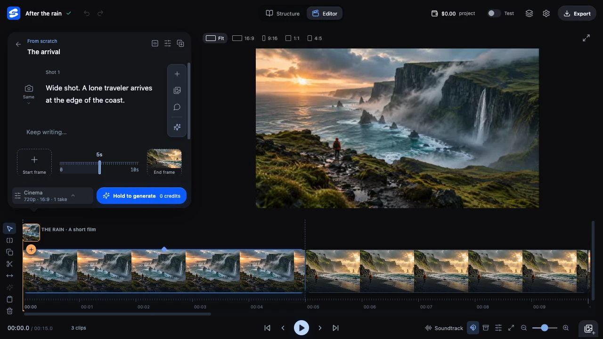

<p align="center"></p>

<h1 align="center">A video studio built for AI.</h1>
<p align="center">Free. Open source. Local by design. Bring your own API keys.</p>
<p align="center"><a href="https://www.splece.com/#download">Download desktop beta</a> · <a href="docs/guide/README.md">Docs</a> · <a href="docs/guide/prompting.md">Prompting</a> · <a href="docs/guide/providers.md">Providers</a> · <a href="CONTRIBUTING.md">Contribute</a></p>


*Real desktop editor capture with staged AI imagery. Interface details evolve during beta.*

Plan on a canvas. Direct a generation. Compare takes. Make the cut.

Splece brings AI generation and video editing into one local workspace. References, prompts, model choices and alternative takes belong alongside the timeline, so you can keep the good parts and work on what needs another pass.

## Your film. Your workflow.

- **Direct with context.** Keep characters, locations and visual references in the Media Library. Shape the story on the canvas and inspect the prompt before submitting it.
- **Keep your options.** Generate supported variations, compare takes, and refine the edit with the playhead, trim controls, sound and elements.
- **Choose your connections.** Use your own supported provider accounts for writing, images, video and sound. Provider adapters live separately from the editor.
- **Work locally.** Project files, imported media and exports live on your computer. The desktop app opens the studio in your browser.
- **Start without a key.** Edit imported media and explore Offline mode without paid AI inference. Online generation is billed by your chosen provider.

Splece itself is free. Provider credits are separate. Online generation sends the required prompts and media to that provider; local editing does not mean cloud generation happens on your device.

## Get Splece

| Platform | Download | Beta details |
|---|---|---|
| macOS | [Mac beta](https://www.splece.com/beta/) | Apple Silicon · macOS 13+ · signed and notarized |
| Windows | [Windows beta](https://www.splece.com/beta/windows/) | x64 · Windows 10/11 · unsigned; publisher warnings may appear |
| Linux | [Linux beta](https://www.splece.com/beta/linux/) | Experimental amd64 .deb · Ubuntu 22.04+ / compatible Debian 12+ |
| iOS / Android | Coming soon | In development; no public mobile download or release date yet |

Desktop installers bundle the core runtime and video tools. Optional local add-ons have separate requirements. The existing desktop downloads are **0.1.4 beta**; this source release contains newer work. Check [release notes](https://github.com/ahmadaIanazi/splece/releases) before comparing features.

## Start here

[Your first project](docs/guide/getting-started.md) → [Connect a provider](docs/guide/providers.md) → [Write a shot](docs/guide/prompting.md) → [Understand local storage](docs/guide/privacy.md)

## Provider support

| Connection | Implemented task families in this source release |
|---|---|
| Venice | Writing, images and mapped video workflows |
| xAI / Grok | Mapped image generation/editing and video workflows |
| fal.ai | Mapped image, video and sound workflows; optional |
| OpenAI | Writing and assistance |
| OpenRouter | Writing and assistance; compatible vision-capable models where supported |
| DeepSeek | Writing, planning and assistance |

Support means implemented mappings, not every model or feature sold by the provider. Availability depends on your account and the discovered catalog. Direct xAI transport is covered by mocked tests; live xAI generation has not been verified for this release.

**Replicate, RunPod and arbitrary custom endpoints are not plug-and-play connections today.** Developers can add adapters. An OpenAI-compatible text endpoint is not a universal video API, and MCP control is a separate integration. Read [provider support](docs/guide/providers.md) and [adding a provider](docs/guide/provider-adapters.md).

## Run from source

Install Git and Node.js 22.13+ (Node 22 LTS recommended), then:

```sh
git clone https://github.com/ahmadaIanazi/splece.git
cd splece
npm ci
npm run build
npm run dev
```

Open **http://127.0.0.1:4310**. No provider key is needed to start. `npm test` runs the regression suite with mocked providers and disposable test data.

Installation downloads dependencies and FFmpeg. The app invokes FFmpeg as a separate executable; `FFMPEG_BIN` can select a compatible local binary. See [development](docs/guide/development.md) for platform requirements and isolated workspaces.

## Build with us

Provider adapters, first-run reliability, accessibility and editing improvements are welcome. Start with [CONTRIBUTING.md](CONTRIBUTING.md). Report bugs with a small reproducible example and no keys or private media. See [SECURITY.md](SECURITY.md) for private reports.

[iOS and Android are coming soon](docs/guide/roadmap.md). This repository currently publishes the desktop studio; mobile is being developed separately.

## License and credit

Created by [Ahmad Alanazi](https://github.com/ahmadaIanazi).

Original Splece code is [Apache-2.0](LICENSE): commercial use and closed-source derivatives are allowed under its terms. Preserve applicable notices and identify modifications. A visible “Built with Splece” credit is appreciated, not required: [attribution](ATTRIBUTION.md).

The **Splece name, logo and app icon are reserved** for the official project. Use your own branding for distributed forks; see [trademarks](TRADEMARKS.md). Third-party code, fonts, models and executables retain their own licenses: [notices](THIRD_PARTY_NOTICES.md). This source release does not include desktop installer binaries or FFmpeg binaries.
