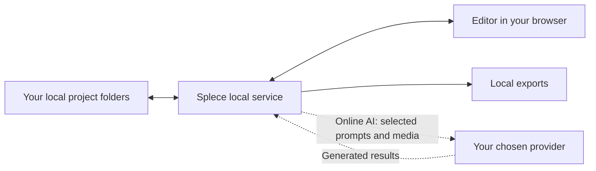

# Local editing. Optional online AI.

The installed app runs a service on your computer. Your browser displays its editor. The public Splece website is not storage for your desktop projects.

## What stays on your computer

Projects, imported media, edit decisions and exports are stored locally. Provider keys are stored by the local service outside portable project bundles; the server does not return saved key values to the editor. Treat the app data folder and backups as sensitive.

| Installation | Data location |
|---|---|
| macOS | `~/Library/Application Support/Splece` |
| Windows | `%LOCALAPPDATA%\Splece` |
| Linux | `$XDG_DATA_HOME/Splece` or `~/.local/share/Splece` |
| Source development | `data/` by default; override with `STUDIO_DATA_DIR` |

## What can use the network

Online generation and writing send the required prompts, selected media and settings to your chosen provider. Its retention, billing and usage policies apply. Connection verification also makes network requests even though it does not generate media. Updates, dependency/add-on downloads and optional online sound search use the network separately.

**Offline** pauses AI inference. It is not an operating-system firewall and does not promise zero network traffic from every action. Existing accepted provider jobs may still require status/download recovery; pausing does not reverse a submitted charge.

Back up your projects. Before sharing logs, screenshots or a repository, remove keys, private paths and personal media. Use [private security reporting](../../SECURITY.md) for vulnerabilities.
