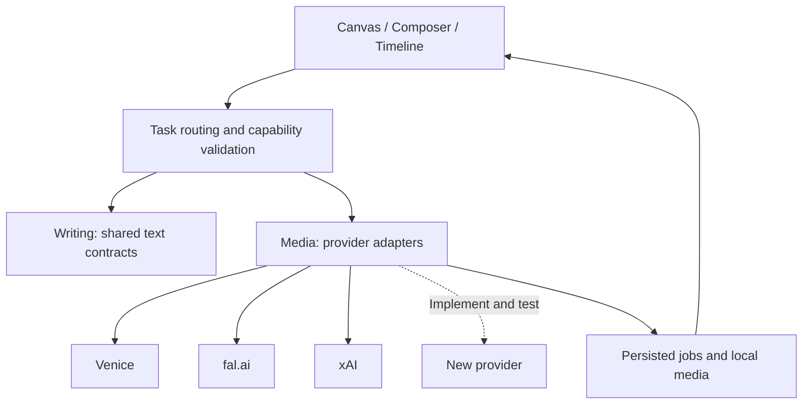

# Add a generation provider

Splece separates editing from provider requests. Extending it currently means contributing code, not pasting an arbitrary base URL into Settings. There is no stable third-party plugin SDK promised by this beta.

## Find the existing contracts

| Concern | Source |
|---|---|
| Provider IDs, account links, authenticated hosts | [`shared/providers.mjs`](../../shared/providers.mjs) |
| Task lanes, text endpoints, routing validation | [`shared/ai-routing.mjs`](../../shared/ai-routing.mjs) |
| Credentials and connection status | [`server/connections.mjs`](../../server/connections.mjs) |
| Media adapter construction and discovery | [`server/provider-registry.mjs`](../../server/provider-registry.mjs) |
| Venice adapter | [`server/providers.mjs`](../../server/providers.mjs) |
| fal adapter | [`server/adapters/fal.mjs`](../../server/adapters/fal.mjs) |
| xAI adapter | [`server/adapters/xai.mjs`](../../server/adapters/xai.mjs) |
| Image models and execution | [`shared/asset-generation.mjs`](../../shared/asset-generation.mjs), [`server/asset-images.mjs`](../../server/asset-images.mjs) |
| Input preparation and video workflows | [`server/domain.mjs`](../../server/domain.mjs), [`server/video.mjs`](../../server/video.mjs) |
| Persisted jobs and recovery | [`server/jobs.mjs`](../../server/jobs.mjs) |
| Global Online switch | [`server/online.mjs`](../../server/online.mjs) |
| Restricted network transport | [`server/security.mjs`](../../server/security.mjs) |

## Add one workflow first

1. Define a stable provider ID and only the task families you implement. Add account links and exact authentication hosts. Do not allow unrestricted authenticated URLs.
2. Integrate credentials through existing local storage. Verification should query a harmless catalog/account endpoint, not paid inference.
3. Map one exact model/workflow. Normalize prompt limits, reference roles/counts, duration, resolution, audio support and pricing basis. Preserve original inputs for capability checks.
4. Follow an existing adapter's `catalog`, `quote`, `submit` and `poll` contracts for video. Image, text and sound tasks have their own contracts; do not force them into a generic video payload.
5. Honor the Online gate immediately before submission/upload. Use the shared restricted transport, timeouts and host validation. Never forward API credentials to an output download host.
6. Persist accepted request IDs and immutable request snapshots. Resume polling after restart. An uncertain submission must not automatically generate again; downloading an existing result must not resubmit it.
7. Surface unsupported inputs and unknown costs explicitly. A catalog entry alone is not proof the workflow is usable. Keep the last good catalog on discovery failure.
8. Add connection UI/help and mocked tests. Document the exact supported scope and any live verification still needed.

## Test without spending credits

Use injected fake transports and disposable data directories. Existing examples: [`provider-registry.test.mjs`](../../tests/provider-registry.test.mjs), [`model-selection-xai.test.mjs`](../../tests/model-selection-xai.test.mjs), and [`ai-routing.test.mjs`](../../tests/ai-routing.test.mjs).

Cover authentication failure, unsupported fields, reference ordering, schema drift, Offline submission blocking, uncertain acceptance, restart recovery, output-host rejection and download retry. Confirm manual model choices survive input changes and reloads. Run the full regression suite before a pull request.

Live inference is a separate, explicitly budgeted validation step. Do not describe mocked responses as verified provider output.

## What about Replicate, RunPod or MCP?

Replicate and RunPod require task-specific adapters and capability mappings before they can be selected here. OpenAI-compatible text transport does not normalize their media jobs. MCP would expose agent tools; it would not replace provider adapters, authentication or paid-request controls. Neither ComfyUI nor MCP is a prerequisite for the implemented cloud routes.
